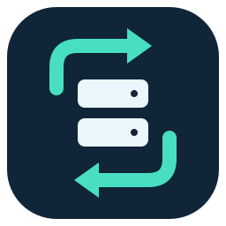

# Oh My Backup



A Windows desktop companion for keeping remote Veeam backup sets in sync over SSH. Written in Rust with egui. Turkish and English are available from the language selector and Settings.

## Use

Download the versioned Windows ZIP from this repository's Releases, extract it, and run `oh-my-backup.exe`. To install a stable copy and create desktop/Start menu shortcuts, run `./install.ps1` from the extracted folder in PowerShell. Administrator access is not required. Pin the new shortcut; an old pin can retain Windows' cached icon until replaced.

Open Settings and enter your server, SSH username/password, remote folder and local backup destination. New installations contain no server credentials and do not start automatic transfers. The SSH server needs Python 3 and a Linux `/proc` filesystem. The local filesystem must support the file operations used by the selected update mode; NTFS is recommended.

The first connection records the server's SSH key fingerprint. Verify the fingerprint through a trusted channel before relying on the connection. Changed keys are rejected. Saved passwords use Windows DPAPI for the current Windows user.

## Behavior

- Block-level delta downloads and resumable checkpoints avoid downloading unchanged data.
- In-place mode minimizes writes. The local live set can be incomplete while its full-backup file is updated. Safe mode prepares a separate set and needs more disk space.
- Continuous, every-N-days, weekday and manual plans support per-backup overrides and allowed hours.
- Job windows are estimated from backup filenames and timestamps; server file activity is also checked. Estimates are not a substitute for restore testing.
- Missing or truncated local files invalidate the current-state indicator and are scheduled for repair, subject to pause/exclusion and server safety windows. Local size checks do not detect same-size bit corruption.
- Approved legacy folders may be deleted before downloading when the free-space-first option is enabled. Review approvals carefully.
- Exiting during a transfer prompts to stop and checkpoint the operation first.
- Only one production sync process is allowed, including `--once`. An offline `--preview` process can run independently.

For compatibility with existing installations, settings remain in `%APPDATA%/HBSync`, logs retain the HBSync naming, and per-destination metadata remains in `.hbsync`. `HBSYNC_CONFIG` can select a different configuration file. Existing settings are preserved; old settings without a language default to Turkish. Log entries retain the language used when they were created.

## Development

The repository pins Rust 1.93.0. Use the Windows MSVC target and Windows SDK resource compiler. `RC` may point to `rc.exe`. Python 3 is used by the source privacy check. No Python installation is needed on the client for normal desktop operation.

```powershell
cargo fmt --check
cargo clippy --locked --all-targets -- -D warnings
cargo test --locked
cargo run --locked -- --preview
./scripts/package.ps1
```

The embedded executable icon contains nine sizes from 16 to 256 pixels. `assets/logo.svg` is the editable mark. Regenerate the PNG, raw window icon and ICO with `./scripts/generate-icons.ps1`.

`python scripts/check-source-privacy.py --staged` scans staged content for private paths, IP addresses, saved credentials and common key/token patterns without printing matching values. It is a focused safeguard, not a comprehensive security audit. Local config, metadata, logs and generated files must stay ignored.

## Versioning

`Cargo.toml` is the version source. Use Semantic Versioning and record user-facing changes in `CHANGELOG.md`. For each release:

1. Update the package version and lockfile, then add release notes.
2. Run the format, lint, test, privacy and package checks.
3. Commit, tag the exact commit as `vMAJOR.MINOR.PATCH`, and push the branch and tag.
4. The Windows workflow validates the tag/version match and attaches the ZIP and SHA-256 checksum to a GitHub Release. Verify the hosted workflow before distributing it.

Releases from this private repository inherit its access restrictions. Builds are unsigned.

## License

Licensed under the [MIT License](LICENSE).
